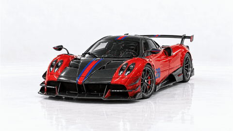

# Huayra BC: Emotion, in Rosso

An independent automotive portfolio concept by [iBithun](https://portfolio.ibithun.com). One red Huayra travels through an editorial website, with two scroll-controlled films and an annotated exploded study. This is not a dealership or an official Pagani website. Inquiries go to iBithun about website projects.

**[Explore the website](https://demo-pagani.ibithun.com)** · **[Watch the film](https://demo-pagani.ibithun.com/teaser)** · **[Work with iBithun](https://portfolio.ibithun.com)**

## Cinematic preview

[](https://demo-pagani.ibithun.com/teaser)

This silent 19-second film is the approved short orbit, opening, explosion and return sequence used by the website. It is a product-film preview, not a recording of the entire website. Click the animated image for the 720p player with playback controls, seeking, fullscreen and download.

[Video in this repository](public/media/pagani-anatomy-19s.mp4) · [Download the MP4](https://demo-pagani.ibithun.com/media/pagani-anatomy-19s.mp4)

## Run locally

Node 22.12 or later:

```sh
git clone https://github.com/goldenbutter/pagani-huayra.git
cd pagani-huayra
npm ci
npm run dev
```

Development runs at http://localhost:3001. Production preview:

```sh
npm run build
npm run start -- --port 3002
```

No API keys or environment variables are required. `demo-pagani.ibithun.com` is the canonical hostname. GitHub and Vercel setup, DNS status and analytics instructions are recorded in [DEPLOYMENT.md](DEPLOYMENT.md).

## The experience

- One persistent canvas follows layout docks, with gentle lift and tilt between sections, following the ENERGITIX product-scene approach.
- First film: full orbit, overhead view, open doors and engine cover, then reverse to the assembled starting pose. It never enters the explosion segment.
- Second film: short left orbit, opening, explosion, a reading pause with six selectable part labels, then reverse to the same starting pose.
- Both films share 913 native frames from the accepted red master. Reverse playback reuses frames without duplicate downloads. Scroll distance controls pace; these are not autoplay videos.
- A sampled `#fbfbfb` studio colour is shared by the page and canvas surface. Feathered frame boundaries remove the rectangular edge. The travelling still uses a background cutout; floor reflections stay in the films.
- Desktop frames are 1280 × 720, approximately 36.3 MB. Mobile frames are 768 × 432, approximately 18.6 MB. Full loading starts after the visitor begins scrolling. Prioritised requests service the current position; at most 24 decoded frames are cached.
- Reduced motion shows stills instead of the long scroll films. Failed motion requests retain a visible image and offer retry. Navigation, details and labels support keyboard interaction.
- The technical portrait uses production Huayra BC Coupé specifications, including power, torque, Xtrac AMT, weight, drive, brakes, suspension and wheels. Source links appear on the page. The generated exploded illustration is conceptual, not an engineering disassembly manual.

## Media organisation

```text
assets/source/images/         Original generated images, all colours preserved
assets/source/videos/         Original supplied and generated clips
assets/archive/three-color-site/
                              Retired public frames, white/green images,
                              old exploded artwork and previous documentation
exports/kling4/                Accepted master and edited videos
  v3-two-stage/                Approved exploration and anatomy edits
public/assets/studio/
  desktop/0000..0912.webp      Web-ready desktop film frames
  mobile/0000..0912.webp       Web-ready mobile film frames
  poster.webp                 Starting pose
  manifest.json               Source, frame ranges, sizes and background
public/assets/images/         Red reference stills and social preview
public/media/                 README animation, 720p MP4 and film poster
app/teaser/                   Accessible film player with social metadata
docs/prompts/                 Generation prompts and continuity instructions
scripts/                      Media preparation and browser verification
analysis/                     Local evidence and source rollback, gitignored
```

Source files and backups are preserved locally. `assets/`, `exports/`, `analysis/` and provider receipts are excluded from this public repository and deployment. A fresh clone includes all runtime assets but not the local production library. Inactive colours are outside the publicly served directory. Historical components/scripts remain available for reference but the route renders `RedExperience` and `TravellingCar` only; the archived three-colour setup is not active.

## Commands

| Command | Purpose |
| --- | --- |
| `npm run lint` | ESLint |
| `npm run typecheck` | TypeScript |
| `npm run build` | Production build |
| `npm run test:visual` | Chromium/WebKit responsive interaction checks |
| `npm run test:a11y` | axe-core WCAG A/AA scans |
| `npm run prepare:sequences` | Rebuild the red desktop/mobile WebP frames |
| `npm run generate:og` | Rebuild the red-only social image |

Tests default to http://localhost:3002. Override with `BASE_URL`. Frame preparation requires Python, Pillow and ffmpeg; it does not use paid generation credits. Browser tests require Playwright Chromium and WebKit. See [TESTING.md](TESTING.md) for evidence and limitations.

## Traffic analytics

The official `@vercel/analytics` SDK is installed in the root layout, covering `/` and `/teaser`. Enable Web Analytics in the [iBithun project dashboard](https://vercel.com/i-bithun/pagani-huayra/analytics) to view visitors, page views, referrers and device breakdowns. Dashboard enablement and observed production collection are separate from SDK installation; see [DEPLOYMENT.md](DEPLOYMENT.md) for the verified status. Local development uses the SDK's development mode.

## Agent instructions

[AGENTS.md](AGENTS.md) records the approved red-only experience, motion sequence boundaries, source-preservation rules, verified vehicle facts, checks and exact publishing targets.

## Production-car references

- [Pagani: Huayra BC](https://www.pagani.com/huayra-bc/) is the primary source for the displayed figures, drivetrain, chassis and heritage.
- [Pagani of Chicago: Huayra BC](https://www.paganiofchicago.com/models/huayra-bc/) explicitly identifies the published 1,218 kg as dry weight.
- CV means metric horsepower. The page preserves Pagani's 764 CV unit instead of labelling it as mechanical horsepower. Earlier brief claims about top speed and acceleration are not presented as verified figures.

## Known media limits

AI-generated footage includes accepted geometric/interior drift, including the steering-wheel side switch identified by the user. It has not been regenerated or represented as repaired. Studio lighting and floor reflections vary across the source film even though the page colour and boundary blend match. The native source is 720p, so large desktop display cannot add detail. No real CAD model, physical-phone verification or real-network performance certification is claimed.

Designed and developed by Bithun Chatterjee / iBithun. No open-source licence is granted for the design or media; dependency and font licences remain their own.
